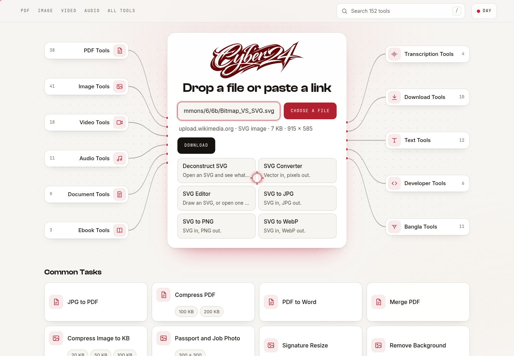
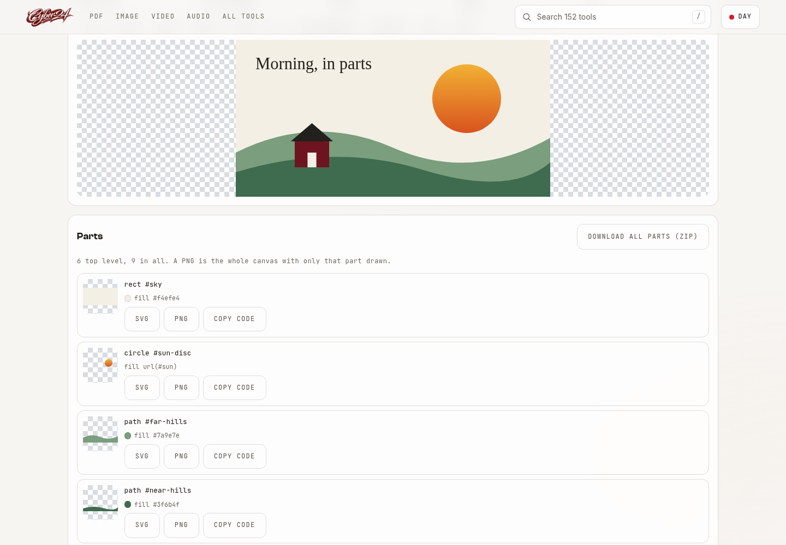
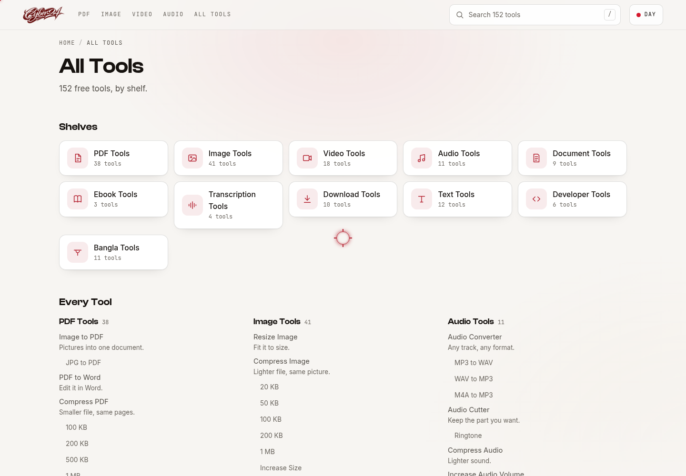

# Cyber24: free online file tools, video downloader, and transcriber

**A workbench of 152 small, fast file tools. Paste any link or drop any file and it offers the tools that fit. Download public video, convert PDFs, images, SVGs, audio and video, transcribe speech, tidy text, and read ebooks. No accounts, no queues, nothing kept.**

[Website](https://cyber24.dev) ·
[All tools](https://cyber24.dev/tools) ·
[Android app](https://cyber24.dev/app) ·
[Privacy](https://cyber24.dev/privacy) ·
[Discussions](https://github.com/720pixel/cyber24-file-tools/discussions)

---

## What Cyber24 is

Cyber24 is a free, no-account **online file toolkit** at [cyber24.dev](https://cyber24.dev): a single, quiet workbench for the small jobs people reach for every day. Paste a link and it says what is there: a social profile (with its handle, and the account ID when the link carries one), a post or video, a file, or a page, with the tools that fit and a plain Download for files. Drop a file and it is read by its contents, not its name. Drop a file and change its format. Read a talk without watching it. Every tool states what it accepts, what it returns, and what runs underneath. Files are processed and deleted the instant the result is ready, and within the hour either way. Most tools need no sign-in.

The same toolkit ships as a **native Android app** that runs the heavy work on the device, so downloads go over your own connection and your files stay on your phone.

## Screenshots

**The home panel: every tool wired to one core**

**Paste any link: it reads what is there and offers the tools that fit**

**Deconstruct SVG: every part, colour and embedded image, on its own**

**Every tool, grouped by what it does**

## Tools

- **Video downloader and playlist downloader.** Download public video and audio from YouTube, Facebook, Instagram, Twitter and X, TikTok, Reddit, Vimeo, Dailymotion, Twitch, SoundCloud, Bilibili, and well over a thousand more sites. Pick a resolution up to 4K, pull the audio as MP3, M4A, Opus, or WAV with cover art and tags, take the subtitles, grab the poster, cut a section, remove sponsor segments, or take a whole YouTube playlist as separate numbered files. Public content only.
- **Speech to text transcriber.** Turn audio or video into text with an on-box speech model, tuned for Bengali, Hindi, and English, with SRT, VTT, and plain text out.
- **Smart paste and drop.** Paste a social link and get its handle, its account ID when the link carries one, and the ID finder, downloader and transcriber. Paste a direct file link (SVG, PNG, MP3, MP4, PDF, TXT, DOCX, EPUB, ZIP and more) and get its type, size and dimensions, a plain Download, and every tool that opens it. Tracking tags are stripped and redirect links unwrapped. Links are checked on the server against private addresses and odd ports, and files pass through only as downloads, never as pages.
- **PDF tools.** Merge, split, compress, organize, rotate, crop, watermark, protect, unlock, repair, flatten and OCR PDF; PDF to Word, PDF to images, PDF to text, PDF to PDF/A; redact PDF (the covered text is truly removed, in your browser); compare two PDFs word by word or pixel by pixel; NID and ID card front and back on one page; an in-browser PDF editor and signer.
- **SVG tools.** SVG to PNG, JPG and WebP at any size, Deconstruct SVG (every part, colour, embedded image and the cleaned source), an SVG Editor to build or change drawings, and Image to SVG to trace PNG and JPG into vectors. Every SVG is cleaned of scripts, links and outside references first.
- **Image tools.** Convert images (PNG, JPG, WebP, AVIF, HEIC, TIFF), compress to a target size in KB, resize, passport and job photos, develop camera raw files, strip metadata, QR codes, and remove background with ready pages for transparent PNGs, white or coloured backgrounds, logos, signatures and product photos.
- **Video tools.** Convert, compress, trim and resize video (9:16 Reels and Shorts, 1:1 posts, blurred or plain fill), change speed and make slow motion, stabilize shaky video, merge clips, add or replace music, remove the sound, video to GIF, and extract audio.
- **Audio tools.** Convert and compress audio (MP3, WAV, M4A, FLAC, Opus, OGG), remove background noise, normalize or boost volume without clipping, cut audio and make ringtones, merge tracks with crossfade, and edit MP3 tags.
- **Document and ebook tools.** Convert Word, spreadsheets, and slides, edit CSV and TSV, and reshape ebooks for any reader, plus an EPUB reader.
- **Text and developer tools.** Case converter, character count, fancy Unicode text, strikethrough and decorations, a URL cleaner that strips tracking from links, plus base64, hex, binary, hashing, JSON, JWT, and timestamp helpers, all in the browser.
- **Bangla tools.** Bijoy to Unicode and back, SutonnyMJ to Nikosh, and Bangla OCR.
- **Social ID finder.** Turn a public Facebook, Instagram, X, or TikTok profile link into its numeric account ID.

## Android app

The [Cyber24 Android app](https://cyber24.dev/app) is a native Jetpack Compose build, not a WebView.

- On-device **yt-dlp** downloads public video over your own IP, including whole playlists queued and saved as separate files.
- On-device **ffmpeg** for audio conversion, an on-device PDF viewer, and image, text, spreadsheet, and document tools that never touch the network.
- Optional sign-in with two-factor and a biometric lock. Public tools need no account.
- Free, on [Google Play](https://play.google.com/store/apps/details?id=dev.cyber24.app) and as a signed APK updated over the air. The APK keeps the YouTube downloader; the Play build leaves YouTube out, because Play does not allow it.

## Tech stack

| Layer | What it uses |
| --- | --- |
| Frontend | Next.js 16 (App Router), React 19, TypeScript, Tailwind CSS v4 (CSS-first, no config file) |
| Backend | Node.js, Zod validation at every boundary, BullMQ workers, Redis, PostgreSQL, better-auth |
| Media engines | ffmpeg, yt-dlp, whisper.cpp (large-v3-turbo), sharp, pdf-lib, pdf.js, JSZip |
| In-browser | ffmpeg.wasm for on-device audio conversion and remux |
| Android | Native Kotlin and Jetpack Compose, bundled on-device yt-dlp and ffmpeg, MV3 browser extension |
| Infrastructure | Self-hosted behind nginx, Cloudflare for DDoS and real-client-IP, systemd, per-IP rate limiting |
| Security | HTTPS in transit, isolated per-job scratch erased on completion, no long-term file storage, secure API keys hashed with SHA-256 |

## Links

- Website: <https://cyber24.dev>
- All tools: <https://cyber24.dev/tools>
- Android app and APK: <https://cyber24.dev/app>
- Privacy policy: <https://cyber24.dev/privacy>
- Questions and access requests: [open a discussion](https://github.com/720pixel/cyber24-file-tools/discussions) or email <admin@cyber24.dev>

## Source and access

Cyber24 is **not open source**. Parts of it depend on custom tooling and infrastructure that are kept private. The code is not published here.

You are welcome to look, ask questions, and request access:

- Open a thread in [Discussions](https://github.com/720pixel/cyber24-file-tools/discussions) to talk about a tool, report a problem, or suggest one.
- For access to a specific tool, the API, or a collaboration, email <admin@cyber24.dev> with a short note on what you need it for.

This repository holds the description and links only. All rights reserved.

## Keywords

Free online file tools, online file converter, paste link file tools, SVG to PNG, SVG to JPG, SVG editor, deconstruct SVG, image to SVG, PNG to SVG, redact PDF, compare PDF, PDF to PDF/A, NID card front and back PDF, remove background noise, increase audio volume, audio cutter, ringtone maker, merge audio, change video speed, stabilize video, merge videos, resize video for Reels, add music to video, remove audio from video, make background transparent, URL cleaner, video downloader, YouTube downloader, YouTube playlist downloader, YouTube to MP4, YouTube to MP3, Facebook video downloader, Instagram reels downloader, Twitter and X video downloader, TikTok downloader, Reddit video downloader, SoundCloud downloader, playlist downloader, YouTube subtitle downloader, download captions, speech to text, audio transcription, video transcription, Bengali transcription, Hindi transcription, generate subtitles, PDF converter, merge PDF, split PDF, compress PDF, unlock PDF, PDF to text, image converter, compress image, resize image, WebP converter, AVIF converter, EXIF viewer, video converter, MP4 converter, compress video, trim video, video to GIF, extract audio, audio converter, MP3 converter, WAV to MP3, FLAC to MP3, document converter, Word to PDF, spreadsheet converter, EPUB reader, ebook converter, text tools, case converter, fancy text generator, base64 encoder, hex converter, JWT decoder, hash generator, find Facebook ID, find Instagram ID, Android video downloader app, yt-dlp app, ffmpeg on device, private file tools, no account file converter, secure file conversion, files deleted after conversion.

Built and run by the Cyber24 owner. Live at [cyber24.dev](https://cyber24.dev).

