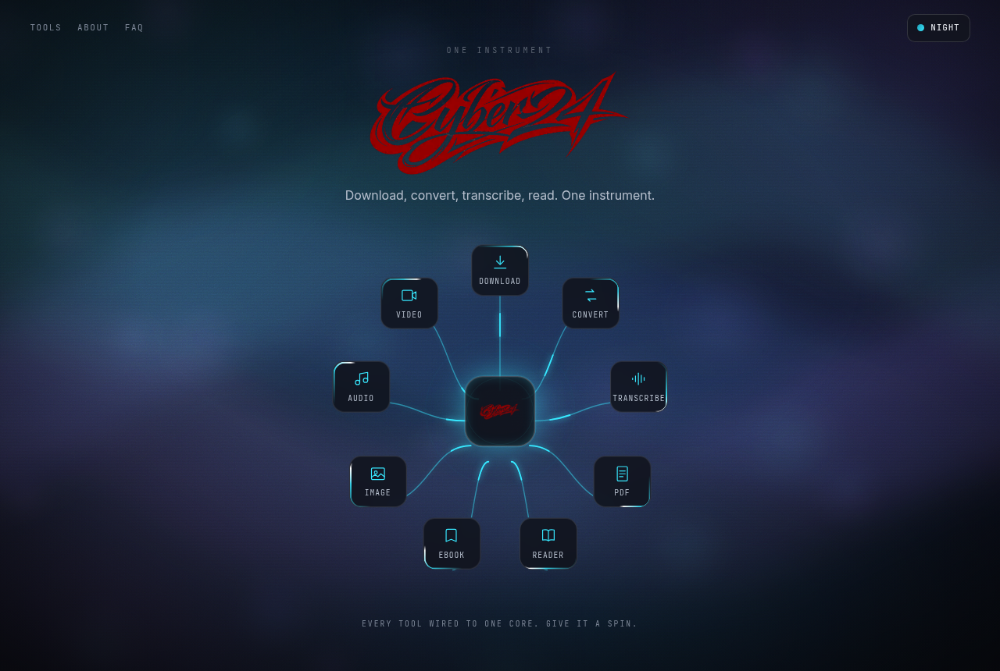

# Cyber24: free online file tools, video downloader, and transcriber

**A workbench of small, fast file tools. Download public video, convert PDFs, images, audio and video, transcribe speech, tidy text, and read ebooks. No accounts, no queues, nothing kept.**

[Website](https://cyber24.dev) ·
[All tools](https://cyber24.dev/tools) ·
[Android app](https://cyber24.dev/app) ·
[Developer API](https://cyber24.dev/developers) ·
[Privacy](https://cyber24.dev/privacy) ·
[Discussions](https://github.com/720pixel/cyber24-file-tools/discussions)

---

## What Cyber24 is

Cyber24 is a free, no-account **online file toolkit** at [cyber24.dev](https://cyber24.dev): a single, quiet workbench for the small jobs people reach for every day. Paste a link and pull the video. Drop a file and change its format. Read a talk without watching it. Every tool states what it accepts, what it returns, and what runs underneath. Files are processed and deleted the instant the result is ready, and within the hour either way. Most tools need no sign-in.

The same toolkit ships as a **native Android app** that runs the heavy work on the device, so downloads go over your own connection and your files stay on your phone.

## Screenshots

**The home panel: every tool wired to one core**

**Every tool, grouped by what it does**

## Tools

- **Video downloader and playlist downloader.** Download public video and audio from YouTube, Facebook, Instagram, Twitter and X, TikTok, Reddit, Vimeo, Dailymotion, Twitch, SoundCloud, Bilibili, and well over a thousand more sites. Pick a resolution up to 4K, pull the audio as MP3, M4A, Opus, or WAV with cover art and tags, take the subtitles, grab the poster, cut a section, remove sponsor segments, or take a whole YouTube playlist as separate numbered files. Public content only.
- **YouTube subtitle and caption downloader.** Save caption tracks and auto-generated captions from any public YouTube video as SRT, VTT, plain text, Markdown, or JSON, with or without timestamps.
- **Speech to text transcriber.** Turn audio or video into text with an on-box speech model, tuned for Bengali, Hindi, and English, with SRT, VTT, and plain text out.
- **PDF tools.** Merge PDF, split PDF, compress PDF, unlock PDF, PDF to text, and an in-browser PDF viewer and editor.
- **Image tools.** Convert images (PNG, JPG, WebP, AVIF, TIFF), compress images, resize images, develop camera raw files, and read or strip EXIF metadata in the browser.
- **Video tools.** Convert video (MP4, WebM, MKV), compress video, trim video, video to GIF, and extract audio from video.
- **Audio tools.** Convert audio (MP3, WAV, M4A, FLAC, Opus, OGG) and compress audio. On the web and the app these run on your device where the browser supports it, so the file never leaves it.
- **Document and ebook tools.** Convert Word, spreadsheets, and slides, edit CSV and TSV, and reshape ebooks for any reader, plus an EPUB reader.
- **Text and developer tools.** Case converter, character count, fancy Unicode text, strikethrough and decorations, plus base64, hex, binary, hashing, JSON, JWT, and timestamp helpers, all in the browser.
- **Social ID finder.** Turn a public Facebook, Instagram, or X profile link into its numeric account ID.

## Android app

The [Cyber24 Android app](https://cyber24.dev/app) is a native Jetpack Compose build, not a WebView.

- On-device **yt-dlp** downloads public video over your own IP, including whole playlists queued and saved as separate files.
- On-device **ffmpeg** for audio conversion, an on-device PDF viewer, and image, text, spreadsheet, and document tools that never touch the network.
- Optional sign-in with two-factor and a biometric lock. Public tools need no account.
- Free, signed, and updated over the air. Not on the Play Store; sideload the APK.

## Tech stack

| Layer | What it uses |
| --- | --- |
| Frontend | Next.js 16 (App Router), React 19, TypeScript, Tailwind CSS v4 (CSS-first, no config file) |
| Backend | Node.js, Zod validation at every boundary, BullMQ workers, Redis, PostgreSQL, better-auth |
| Media engines | ffmpeg, yt-dlp, whisper.cpp (large-v3-turbo), sharp, pdf-lib, pdf.js, JSZip |
| In-browser | ffmpeg.wasm for on-device audio conversion and remux |
| Android | Native Kotlin and Jetpack Compose, bundled on-device yt-dlp and ffmpeg, MV3 browser extension |
| Infrastructure | Self-hosted behind nginx, Cloudflare for DDoS and real-client-IP, systemd, per-IP rate limiting |
| Security | HTTPS in transit, isolated per-job scratch erased on completion, no long-term file storage, secure API keys hashed with SHA-256 |

## Links

- Website: <https://cyber24.dev>
- All tools: <https://cyber24.dev/tools>
- Android app and APK: <https://cyber24.dev/app>
- Developer API: <https://cyber24.dev/developers>
- Privacy policy: <https://cyber24.dev/privacy>
- Questions and access requests: [open a discussion](https://github.com/720pixel/cyber24-file-tools/discussions) or email <admin@cyber24.dev>

## Source and access

Cyber24 is **not open source**. Parts of it depend on custom tooling and infrastructure that are kept private. The code is not published here.

You are welcome to look, ask questions, and request access:

- Open a thread in [Discussions](https://github.com/720pixel/cyber24-file-tools/discussions) to talk about a tool, report a problem, or suggest one.
- For access to a specific tool, the API, or a collaboration, email <admin@cyber24.dev> with a short note on what you need it for.

This repository holds the description and links only. All rights reserved.

## Keywords

Free online file tools, online file converter, video downloader, YouTube downloader, YouTube playlist downloader, YouTube to MP4, YouTube to MP3, Facebook video downloader, Instagram reels downloader, Twitter and X video downloader, TikTok downloader, Reddit video downloader, SoundCloud downloader, playlist downloader, YouTube subtitle downloader, download captions, speech to text, audio transcription, video transcription, Bengali transcription, Hindi transcription, generate subtitles, PDF converter, merge PDF, split PDF, compress PDF, unlock PDF, PDF to text, image converter, compress image, resize image, WebP converter, AVIF converter, EXIF viewer, video converter, MP4 converter, compress video, trim video, video to GIF, extract audio, audio converter, MP3 converter, WAV to MP3, FLAC to MP3, document converter, Word to PDF, spreadsheet converter, EPUB reader, ebook converter, text tools, case converter, fancy text generator, base64 encoder, hex converter, JWT decoder, hash generator, find Facebook ID, find Instagram ID, Android video downloader app, yt-dlp app, ffmpeg on device, private file tools, no account file converter, secure file conversion, files deleted after conversion.

Built and run by the Cyber24 owner. Live at [cyber24.dev](https://cyber24.dev).

